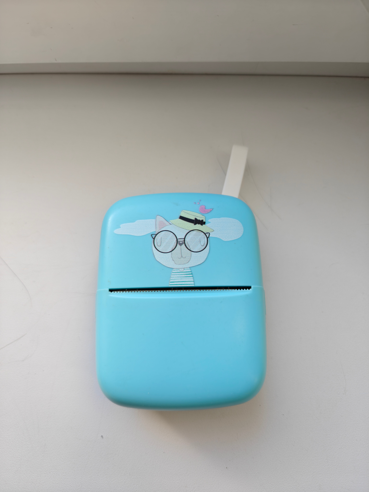

# Material Printer

##### [Русский](README.md) | [English](README_en.md)

> [!WARNING]
>
> Внимание: приложение не поддерживает английский язык.

Этот проект не имеет никакого отношения к оригинальному приложению WalkPrint и компании Shenzhen Yihengke Electronic Technology Co. Ltd.

---

Material Printer - удобное приложение для управления термопринтерами, работающими с приложением "WalkPrint". Писалось на основе оригинального приложения и скрипта [YHK-Cat-Thermal-Printer](https://github.com/abhigkar/YHK-Cat-Thermal-Printer). 

О принтере: принтер транслирует идентификатор «YHK-XXXX», где «XXXX» - это последние четыре символа его MAC-адреса. Неясно почему, но принтер печатает картинки и черные объекты с полосами, возможно, особенность/брак моего. Насколько я понял, они выпускаются в разных форматах (котики, кролики, обычные), но содержат один протокол. В общем, скоро приедет новый, проверю. Мой выглядит вот так:

О приложении:

- 100% офлайн и приватность, в манифесте отсутствует разрешение `INTERNET`.

- Material You

- Поддержка просмотра заряда АКБ.

---

